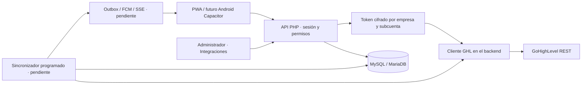

# Ágora Digital Workspace

## Decisión actual

El administrador conecta cada subcuenta mediante su **Private Integration Token (PIT)** desde la app. No se requieren webhooks. Esta decisión del usuario sustituye el flujo de webhooks planteado inicialmente.

La API privada es un método de autenticación y acceso REST, no una suscripción a eventos. Sin webhooks, el backend debe consultar GHL para detectar cambios. La arquitectura utiliza sincronización bajo demanda y, posteriormente, sincronización periódica en segundo plano, con intervalo, paginación, cuotas y backoff por subcuenta.

GHL conserva los datos principales del CRM. Nuestra base organiza usuarios, permisos, configuración de integraciones y proyecciones para lecturas rápidas. La interfaz nunca llama a GHL. No se envía el token a vendedores ni se incluye en el bundle móvil.

## Implementado en esta base

- UI HTML/CSS/JS responsive con manual de Ágora: logotipo vectorial, vino, azul y oro. La tipografía Author Variable necesita el archivo web autorizado; se utiliza fallback de sistema. Inbox, ficha, contactos, pipeline, agenda y tareas contienen datos de demostración.
- Login propio con sesión HttpOnly, CSRF y control de origen; roles administrador/supervisor/vendedor. Consulta de conversaciones por empresa y asignación. No hay usuario de fábrica.
- Panel **Integraciones**: requiere sesión de administrador. Añadir múltiples subcuentas por empresa, guardar Location ID y nombre, sustituir el token, conservarlo al dejar el campo vacío y eliminarlo. Vendedores y supervisores reciben 403 también en backend.
- Cifrado autenticado XChaCha20-Poly1305 con nonce aleatorio y contexto empresa + location. La clave maestra está fuera de `public/`, en `APP_KEY_FILE`; nunca se versiona. Cambiar ciphertext entre empresas o subcuentas impide descifrarlo. Los endpoints sólo devuelven metadatos y `tokenConfigured`, nunca texto plano ni ciphertext.
- Botón de comprobación: el backend llama a `GET /locations/{locationId}`, Version `2021-07-28`, y exige que la respuesta corresponda al Location ID. Necesita `locations.readonly`. Una comprobación positiva no demuestra acceso a todos los módulos, y no activa sincronización. Máximo una comprobación simultánea por conexión; separación de 30 segundos.
- PWA con shell offline y actualizaciones detectables. No se cachean respuestas API ni credenciales.
- Webhooks antiguos **desactivados por defecto** con `GHL_WEBHOOKS_ENABLED=0`. El worker legado pertenece al perfil Compose opcional `webhooks` y no se inicia con el flujo normal. Su código y sus pruebas se conservan como opción futura, no como requisito actual.

## Introducir un token desde la app

Configurar el secreto requiere que el administrador lo escriba temporalmente en un formulario de contraseña y lo transmita por HTTPS a nuestra API. Ésta es la única excepción necesaria a la formulación anterior «nunca en frontend»: **no se distribuye ni se devuelve el token guardado**, pero su introducción inicial sí pasa transitoriamente por el navegador del administrador. No se guarda en localStorage, IndexedDB, service worker o logs. El campo se limpia tras el intento de guardado y al cerrar el modal.

La clave maestra se genera una vez con `bin/generate-key.php`; el comando preserva una clave existente. Perderla hace irrecuperables los tokens cifrados. Mantener un backup seguro separado; para producción usar un gestor de claves, no una clave de desarrollo compartida en una imagen o snapshot. La rotación de tokens está implementada; la rotación de clave maestra requiere un procedimiento de re-cifrado todavía pendiente.

El administrador actual administra las conexiones de **su empresa**. No es un superadministrador global y no puede acceder a conexiones de otros tenants. Preparar selección de subcuenta, membresías y permisos por subcuenta antes de conectar múltiples fuentes al inbox; no mezclar recursos de distintas locations bajo un único ID GHL. El panel ya acepta varias conexiones, pero el read model y la API de conversaciones todavía requieren esa evolución.

## Sincronización y notificaciones

El intervalo configurable (60–3600 segundos) se almacena como preferencia. **El planificador aún no está implementado**; guardar la configuración o comprobar el token no importa contactos ni mensajes. La UI lo indica expresamente.

El siguiente desarrollo es una importación inicial paginada y una sincronización incremental adaptada a los filtros de cada endpoint, con cursores, control de rate limits, bloqueo por subcuenta, reintentos y reconciliación. Un sincronizador no debe asumir que todos los endpoints ofrecen `updatedSince`. Una petición del frontend nunca debe iniciar miles de llamadas síncronas a GHL. Los canales dependen de las conexiones, scopes y restricciones de la subcuenta; se validan individualmente antes de habilitar envío.

Sin webhooks, un mensaje entrante sólo puede generar una notificación cuando el backend detecte el cambio en una consulta. La latencia será aproximadamente el intervalo de sincronización más el procesamiento y la entrega. No es tiempo real estricto. FCM permite notificar con la app cerrada, pero requiere sincronizador y worker de entrega activos en el servidor; un temporizador en el móvil no sirve. FCM/SSE siguen pendientes, igual que las push reales y los App Links nativos. No se promete entrega bajo force-stop, permisos denegados o sin red.

Para minimizar consumo: prioridades por actividad, sincronización más frecuente del inbox, menos frecuente de catálogos, ventanas de atención configurables, presupuesto por location y reconciliación periódica. Esto requiere un planificador real y mediciones de las cabeceras del PIT.

## Resto del producto

Pendientes: sincronización e inbox reales, ficha completa, adjuntos y envíos, acciones rápidas GHL, calendarios/citas reales, auditoría, gestión de usuarios, permisos por acción, MFA/recuperación, FCM, SSE, Capacitor y cola offline idempotente. Los mensajes de ejemplo no salen de la memoria del navegador.

La cola futura debe usar UUID estable por comando, estados queued/sending/confirmed/failed/uncertain, pertenencia de usuario/empresa y precondiciones. Si se pierde la conexión tras un envío, reconciliar antes de repetir: no se supone idempotencia de GHL. Datos offline reales por usuario y tenant con TTL y borrado al cerrar sesión.

## Android y actualizaciones

La PWA instala un shell nuevo en segundo plano y solicita activar la actualización para no perder borradores. Publicar recursos con hash, cambiar versión de caché, mantener compatibilidad de API y preparar rollback antes de producción.

Capacitor no hace actualizable un bundle empaquetado por sí solo. Antes de crear el wrapper, escoger frontend alojado en un origen HTTPS propio con navegación y puente restringidos, o un mecanismo de live updates firmado. Los cambios nativos requieren APK/AAB y, si se publica allí, Google Play. El wrapper no está implementado; tampoco se ha verificado una política vigente de Play para un mecanismo de live updates concreto.

## Despliegue

Compose es sólo desarrollo, con puerto 8080 ligado a loopback y contraseña pública de ejemplo. Producción requiere PHP-FPM detrás de TLS, cookies Secure, límites de tamaño y tasa, backup de base y clave, migraciones, auditoría sin cuerpos ni tokens, observabilidad y restauración probada. No desplegar el servidor integrado de PHP como producción. La configuración de la app no recibe URLs GHL arbitrarias: el host está fijado en el backend.
